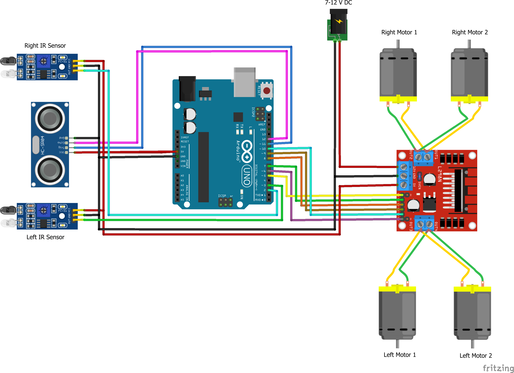
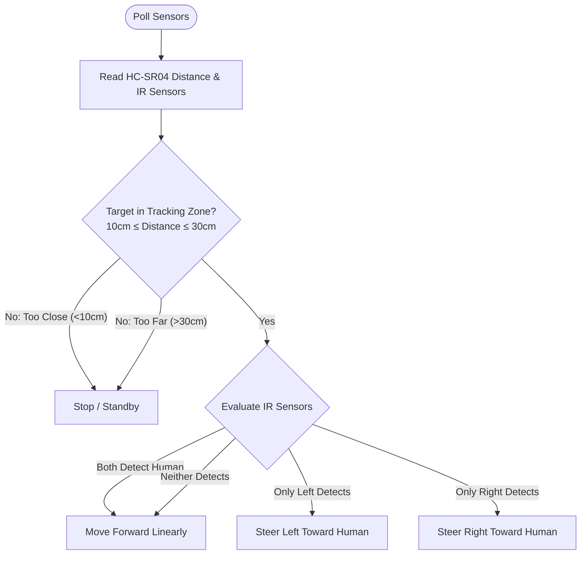

# 🤖 Autonomous Human Following Robotic Carriage

[](https://www.arduino.cc/)
[](https://en.wikipedia.org/wiki/Autonomous_mobile_robot)
[]()
[](https://en.wikipedia.org/wiki/C%2B%2B)
[](LICENSE)
[]()

An autonomous mobile robotic carriage capable of detecting, tracking, and following a human target in real time. The robot fuses sensory data from an ultrasonic rangefinder (for distance tracking) and optical infrared (IR) proximity sensors (for lateral angle tracking), actuating a 4-wheel differential drive chassis via an L298N dual H-Bridge motor driver.

---

## 🖼️ Hardware Circuit Architecture



Complete engineering schematics and design documentation are available in the [`docs/`](docs/) folder:
- **Final Project Report**: [`docs/Human_Following_Robotic_Carriage_Final_Report.docx`](docs/Human_Following_Robotic_Carriage_Final_Report.docx)
- **Formatted Technical Paper**: [`docs/Human_Following_Robotic_Carriage_Formatted_Report.docx`](docs/Human_Following_Robotic_Carriage_Formatted_Report.docx)

---

## 🛠️ Hardware Requirements & Bill of Materials (BOM)

| Component | Specification | Quantity | Function |
| :--- | :--- | :--- | :--- |
| **Microcontroller** | Arduino Uno R3 (ATmega328P, 16MHz) | 1 | Central real-time control system |
| **Ultrasonic Sensor** | HC-SR04 Transducer Module | 1 | Distance measuring and depth buffer |
| **Infrared Sensors** | TCRT5000 / LM393 Optical IR modules | 2 | Left and Right lateral target detection |
| **Motor Driver** | L298N Dual Full-Bridge Driver (2A per bridge) | 1 | High-current DC gearmotor control |
| **DC Motors** | TT Gearmotors (1:48 reduction ratio, 3-6V) | 4 | Robot drive wheels |
| **Robot Chassis** | 4WD acrylic platform with wheels | 1 | Mechanical frame and carriage bed |
| **Power Supply** | 7.4V 2S Li-ion (18650) or 11.1V 3S LiPo battery pack | 1 | Motor and logic power |
| **Jumper Wires & Switch** | High-grade silicone jumpers + SPST toggle switch | 1 set | Power distribution |

---

## 🔌 Pinout Mapping

| Component Lead | Arduino Pin | Description |
| :--- | :--- | :--- |
| **HC-SR04 Trigger** | Digital Pin 11 | Ultrasonic pulse trigger |
| **HC-SR04 Echo** | Digital Pin 12 | Ultrasonic pulse echo capture |
| **Left IR Sensor Digital Out** | Digital Pin 2 | Active LOW on left target presence |
| **Right IR Sensor Digital Out** | Digital Pin 13 | Active LOW on right target presence |
| **L298N ENA (Left Speed)** | Digital Pin 5 (PWM) | Left motor PWM speed regulation |
| **L298N IN1 (Left Dir A)** | Digital Pin 6 | Left motor forward control |
| **L298N IN2 (Left Dir B)** | Digital Pin 7 | Left motor reverse control |
| **L298N IN3 (Right Dir A)** | Digital Pin 8 | Right motor forward control |
| **L298N IN4 (Right Dir B)** | Digital Pin 9 | Right motor reverse control |
| **L298N ENB (Right Speed)** | Digital Pin 10 (PWM) | Right motor PWM speed regulation |

---

## 🧠 Autonomous Control Strategy

The robot uses a multi-sensor target-following state machine:



- **Standby Safety Cushion**: If distance $< 10\text{ cm}$, the robot immediately stops to prevent bumping into the user.
- **Tracking Window**: The robot smoothly tracks when the target is between $10\text{ cm}$ and $30\text{ cm}$.
- **Differential Steering**: If the user takes a left turn, the left IR sensor triggers and the controller pivots left by applying differential drive torque.

---

## 🚀 Installation & Operation

1. Clone repository:
   ```bash
   git clone https://github.com/youniquestar/arduino-human-following-robot.git
   ```
2. Open [`HumanFollowingRobot/HumanFollowingRobot.ino`](HumanFollowingRobot/HumanFollowingRobot.ino) in **Arduino IDE**.
3. Upload sketch to Arduino Uno.
4. Place robot on a flat floor, power the L298N with battery pack, and stand $20\text{ cm}$ in front of the ultrasonic sensor.
5. Walk slowly forward; the robot will track and follow your trajectory automatically.

---

## 📜 License

Open source under the [MIT License](LICENSE).
